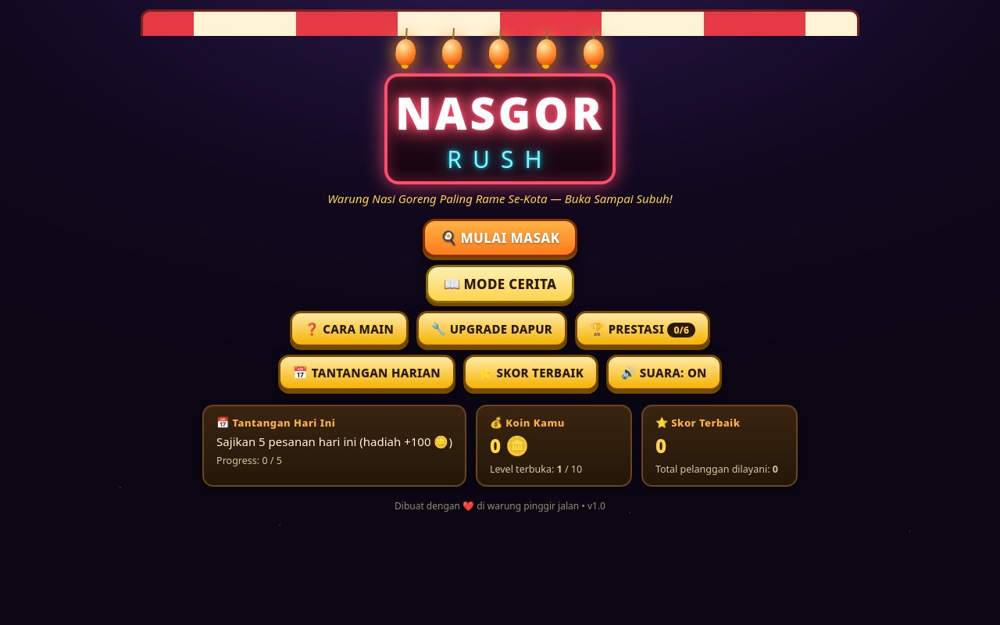
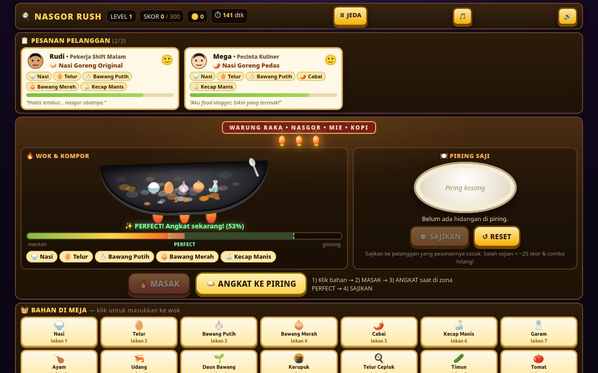
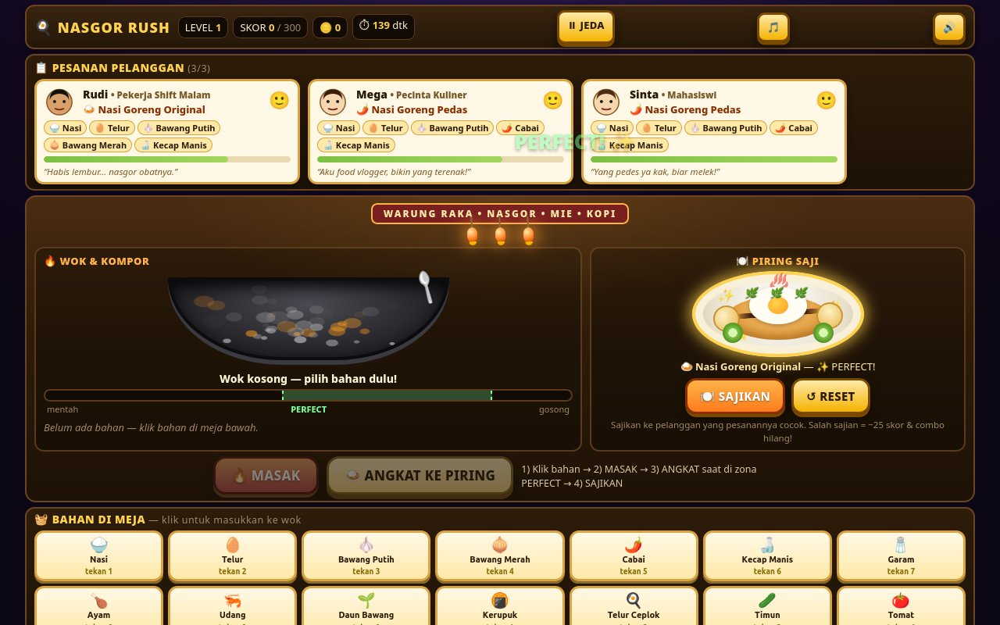
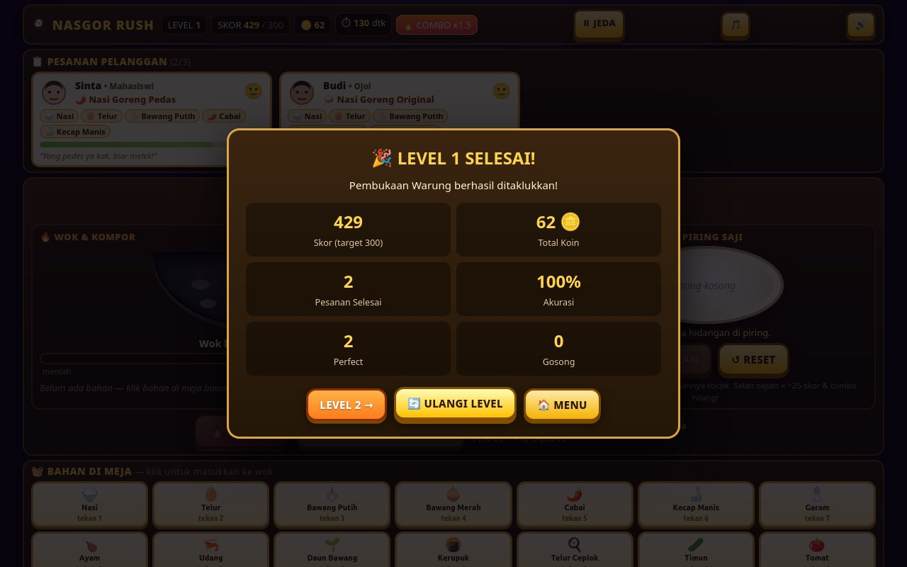

# NASGOR RUSH — Indonesian Street Food 🍳

[](https://make.fun/bounty/best-cooking-game-20261125-0137?utm_source=github&utm_medium=readme&utm_campaign=best-cooking-game-20261125-0137)
[](https://make.fun/bounty/best-cooking-game-20261125-0137/leaderboard?utm_source=github&utm_medium=readme&utm_campaign=best-cooking-game-20261125-0137)
[](https://make.fun/bounty/best-cooking-game-20261125-0137?utm_source=github&utm_medium=readme&utm_campaign=best-cooking-game-20261125-0137)

Entry for the [best-cooking-game-20261125-0137 bounty on make.fun](https://make.fun/bounty/best-cooking-game-20261125-0137).

A complete, playable browser cooking game: run a busy Indonesian nasi goreng
street-food stall at night. Read customer orders, pick the right ingredients,
cook in the wok with perfect timing, and serve before patience runs out.

## How to play

```bash
npm start          # serves game/ at http://localhost:8080
# or: python3 -m http.server 8080 --directory game
```

Open http://localhost:8080 in a desktop browser. No build step, no network
requests at runtime — all art is drawn in code (CSS/SVG/emoji) and all sound
is synthesized with WebAudio.

1. **Read the order board** — each customer shows a recipe and a patience bar.
2. **Click ingredients** on the counter to add them to the wok.
3. Press **🔥 MASAK** and watch the cook bar — press **🍛 ANGKAT** while it is
   inside the green PERFECT zone (undercooked / perfect / burned are real
   states with different scores).
4. Press **🍽️ SAJIKAN** — the dish goes to the customer whose order matches.
   Wrong dish: −25 score and the combo resets.

Shortcuts: `1–9, 0` ingredients, `Space` cook/plate, `S` serve, `R` reset,
`P` / `Esc` pause.

## Features

- **8 recipes** (Original, Pedas, Ayam, Seafood, Spesial, Kampung, Telur with
  double egg, Komplit) with exact multiset validation.
- **8 customer characters** with unique patience, quotes and mood faces,
  including VIP customers (2x reward, low patience).
- **10 levels** with targets, timers, faster spawns and harder recipes —
  level 8 is RUSH HOUR, level 10 is the MIDNIGHT RUSH final challenge.
- **Combo & scoring**: perfect bonus (1.5x), fast-service bonus, consecutive
  perfect combo multiplier (up to x3), customer happiness, VIP multiplier.
- **Daily challenge** (deterministic per date), **6 achievements**, **5 kitchen
  upgrades** bought with earned coins (faster stove, wider perfect zone,
  patience, prep, premium plates) — all with real gameplay effects.
- **Random events**: Rush Hour, VIP Customer, Double Coins, Speed Cooking.
- **Story mode**: illustrated opening cinematic, skippable dialogues between
  levels, story missions with coin bonuses, and a restaurant-success ending.
- **Food presentation**: every served dish gets a dynamic close-up plating —
  fried egg, crackers, cucumber, spring onion, kecap drizzle, steam, and a
  golden treatment for perfect dishes.
- **High scores** (local top 5), unlockable recipes / decorations /
  characters, progress saved in `localStorage`.
- **Game juice**: ingredient bounce, wok shake, flame + steam + smoke
  particles, coin-fly animation, combo pop, screen shake, confetti.
- **Audio**: synthesized SFX (sizzle, ding, coin, success) + a looping
  night-street melody, with independent music/SFX toggles. Never crashes
  without audio.

## Deterministic check

`main.ts` is the Node 22+ entrypoint. It validates every file referenced by
`game/index.html`, re-implements the recipe + cooking-quality rules
headlessly, and simulates all 8 recipes plus edge cases (wrong combo, missing
ingredient, double egg, overcook). No network, no clock, no randomness.

```bash
node main.ts        # writes run-log.json to /output (or ./out), exits 0
node main.ts        # second run is byte-identical
```

## Screenshots

Genuine captures from the running game (Camoufox, 1280×800):






## Tech

- Node.js 22+, plain HTML5 / CSS3 / JavaScript (no framework, no external assets).
- `main.ts` — deterministic validation + headless simulation (Node 22 TypeScript).
- `game/` — static game: `index.html`, `style.css`, `game.js`.
